# DeltaTSynth

Free monophonic bass synth for drum and bass, focused on **reese bass**.
VST3 plugin (plus Standalone) for Windows 64-bit. Tested with FL Studio.

> Closed-source freeware: this repository only hosts the downloads.

## Download

Get the latest zip from the [**Releases**](../../releases/latest) page.

## Install

1. Copy the `DeltaTSynth.vst3` folder to `C:\Program Files\Common Files\VST3`.
2. In FL Studio: *Options > Manage plugins > Find installed plugins*.
3. The Standalone `DeltaTSynth.exe` needs no installation.

The app is not code-signed. If Windows SmartScreen warns you, click
*More info > Run anyway*.

## Features

- Reese engine: 3 detuned saws, clean sine sub, legato/glide, ADSR.
- Ladder filter with envelope and tempo-syncable LFO.
- Drive with 4x oversampling (the sub stays clean).
- **Metal** module: FM operator, comb filter, modal plate resonator.
- Vowel formant filter and attack pitch bend.
- Preset system with categories (Reese, Neuro, Rave, Wobble, Liquid, Stab).

## License

Free to use, including commercial music production, with no royalties.
Redistribution and reverse engineering are not allowed.
See [LICENSE.txt](LICENSE.txt). Built with JUCE (Starter licence) and the
Steinberg VST 3 SDK (MIT). VST is a trademark of Steinberg Media Technologies GmbH.

---

## Español

Sintetizador de bajo gratuito y monofónico para drum and bass, enfocado en
**reese bass**. Plugin VST3 (y Standalone) para Windows de 64 bits.

**Instalación:** descarga el zip desde [Releases](../../releases/latest), copia
la carpeta `DeltaTSynth.vst3` a `C:\Program Files\Common Files\VST3` y
reescanea los plugins en FL Studio. Si SmartScreen avisa, pulsa
*Más información > Ejecutar de todas formas*.

**Licencia:** uso gratuito, también comercial, sin regalías. Prohibido
redistribuirlo o hacerle ingeniería inversa. Ver [LICENSE.txt](LICENSE.txt).
